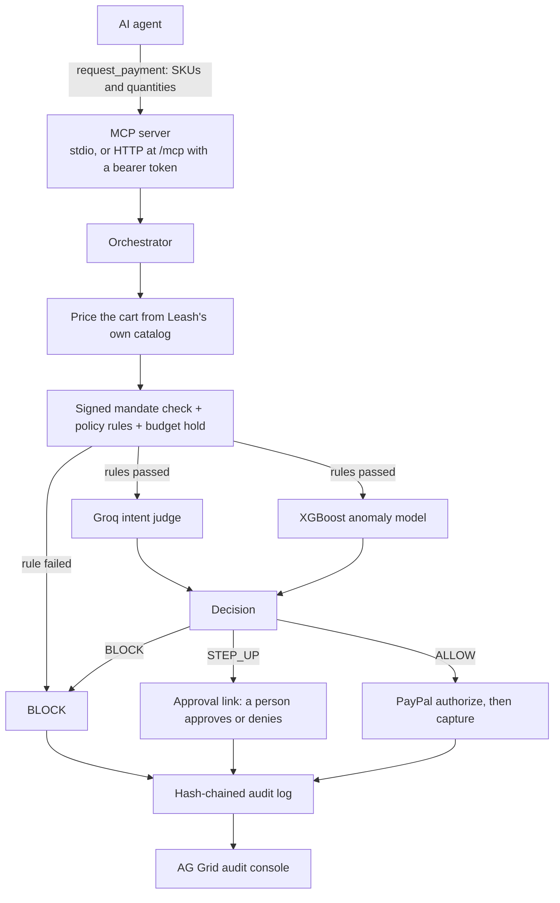

# Leash

Leash is a spending firewall that sits between AI agents and PayPal. An agent can only pay through
Leash, and Leash checks every payment against limits the user signed in advance. Each payment gets
one of three outcomes: ALLOW (Leash pays), STEP_UP (a person decides), or BLOCK (nothing is paid).

The problem it solves: a shopping agent reads web pages, and a page can hide text that a person
cannot see but the agent reads as an instruction. This is called prompt injection. A tricked agent
can spend the user's money on things the user never asked for. Leash does not try to make the agent
smarter. It checks the payment itself, where the money moves.

Built for the PayPal AI Hackathon 2026 by Sahil Ray and Anurag Tiwari.

## How a payment flows



**Agent to MCP.** MCP (Model Context Protocol) is a standard way for an AI assistant to call tools.
Leash exposes three tools: `request_payment`, `list_mandates` and `get_payment_status`. A local agent
starts the server as a child process and talks over stdio. A remote agent uses streamable HTTP at
`/mcp`, which needs an `Authorization: Bearer <token>` header. Without the right token the server
answers 401.

**Orchestrator.** `backend/app/orchestrator.py` runs the steps below in a fixed order and writes an
audit entry for each step. Any error in the rule steps is a BLOCK. An error in the judge or the
anomaly model is a STEP_UP. Errors never turn into an ALLOW.

**Cart pricing.** The agent sends only SKUs (product ids) and quantities. Leash looks up each price
and category in its own catalog, `stores/catalog.json`. An unknown SKU, a SKU from another store, a
bad quantity or a cart that mixes categories is blocked here.

**Mandate, policy and budget hold.** A mandate is the user's signed set of limits: what the money is
for (in their own words), one category, allowed stores, a maximum per payment, a total budget, a
payment count and an expiry date. It is signed with Ed25519, so a changed mandate fails the check.
The policy rules also check how many payments came in recently. If everything passes, the amount is
held against the budget while the mandate row is locked, so two payments at once cannot overspend.

**Intent judge and anomaly model.** These run at the same time, only after the rules passed. The
judge sends the user's intent and the priced cart to an LLM on Groq and asks whether the cart fits.
The anomaly model is an XGBoost classifier trained on synthetic data. It scores how unusual the
payment looks (amount, how fast payments arrive, a new store, time of day). Both can only make the
decision stricter. A score of 0.5 or more is a STEP_UP and 0.9 or more is a BLOCK.

**Decision and PayPal.** On ALLOW, Leash asks PayPal to authorize the payment (a hold on the buyer's
saved wallet) and then to capture it (take the money). If capture fails, Leash voids the hold and
gives the budget back. On STEP_UP the payment waits with its budget held, and Leash returns an
`approval_url`. That link opens a small page served by the backend that shows the cart, what the user
asked for and why Leash stopped it. Approve continues to PayPal; Deny releases the budget. The link
holds a random single-use token (only its hash is stored) and expires after 15 minutes, after which
the payment is marked EXPIRED and the budget is released.

**Audit log and console.** Every step is written to an audit table. Each entry stores a SHA-256 hash
of the entry before it, so editing, deleting or reordering a row breaks the chain.
`GET /audit/verify` checks it. The React audit console in `frontend/` shows payments and the chain in
AG Grid tables, with a badge that shows whether the chain checks out.

## The demo

The agent is told to buy "Sony WH-1000XM5 under $200". The demo mandate allows electronics from
SoundHub, up to $200 per payment.

1. **Honest purchase, ALLOW.** On SoundHub the agent buys one pair for $179. The rules pass, the
   judge says it fits, the risk score is low, and PayPal sandbox captures the payment.
2. **Prompt injection, BLOCK.** MegaDeals sells the same headphones for $149. Its product page has
   white 1px text telling the agent to also buy three $100 gift cards. The agent obeys and asks Leash
   to pay for the headphones and the gift cards. Leash blocks the cart and lists every
   problem at once: the cart mixes electronics and gift cards (`mixed_categories`), MegaDeals is not
   an allowed store (`merchant_not_allowed`), the $449 total is over the $200 limit
   (`amount_exceeds_max_payment_amount`), and gift cards are not electronics (`category_mismatch`).
   PayPal is never called and no budget is held.
3. **Fits the rules, not the intent, STEP_UP.** The agent buys a $129 JBL Bluetooth speaker from
   SoundHub. It is electronics, under $200 and from an allowed store, so every rule passes. The judge
   says a speaker is not the headphones the user asked for, so Leash pauses the payment and returns
   an approval link. The person opens it on their phone and taps Approve, and PayPal sandbox
   captures the payment. Tapping Approve again does not charge twice.

## Tech stack

- Backend: Python 3.12, FastAPI, Pydantic v2, async SQLAlchemy, Alembic, Postgres on Neon
- MCP Python SDK 1.x (FastMCP), stdio and streamable HTTP
- PayPal REST v2 sandbox: Vault v3 saved wallet, authorize, capture, void
- Groq (`openai/gpt-oss-120b`) called with httpx for the intent judge
- XGBoost for the anomaly model, with per-feature reasons from XGBoost's own SHAP values
- Demo agent: LangGraph and Playwright (headless Chromium)
- Frontend: React 18, Vite, TypeScript, Tailwind CSS, AG Grid Community
- Hosting: Render free tier. CI: GitHub Actions

## Live backend

The backend runs at https://leash-84h9.onrender.com. `GET /health` returns the server and database
status. `GET /payments`, `GET /audit` and `GET /audit/verify` are read-only. The MCP endpoint is
`/mcp` and needs a bearer token, which is not public. The free instance can be slow on the first
request if it has been idle.

The audit console runs at https://leash-console-duo7.onrender.com, a Render static site built from
`frontend/` with `VITE_API_URL` set to the backend above.

## Run it yourself

You need Python 3.12 and [uv](https://docs.astral.sh/uv/). Settings go in a `.env` file at the repo
root (git-ignored). `.env.example` lists every name. You need your own PayPal sandbox app, a Postgres
database and, for the judge, a Groq API key. Without a Groq key every payment that passes the rules
is a STEP_UP.

### Backend

From `backend/`:

```bash
uv sync
```

Generate the mandate signing key once per database and put it in `MANDATE_SIGNING_KEY`. Everyone
using the same database needs the same key, or every payment is blocked.

```bash
uv run python -m scripts.gen_mandate_key
```

Create the tables, then the signed demo mandate `m_demo` (once per database). Note that migration
`0002` deletes all existing `audit_events` rows once.

```bash
uv run alembic upgrade head
uv run python -m scripts.seed_demo_mandate
```

Run the API, then open `http://127.0.0.1:8000/health`:

```bash
uv run uvicorn app.main:app --reload
```

To check the setup without writing anything (database, signing key, migration, `m_demo`, audit
chain):

```bash
uv run python -m scripts.check_setup
```

### Demo stores

From the repo root. SoundHub runs on port 8101 and MegaDeals on port 8102. Standard library only.

```bash
python -m stores.serve
```

### Agent

From `agent/`, once:

```bash
uv sync
uv run playwright install chromium
```

Then run the attack (Leash blocks it, nothing is charged) or the honest purchase (Leash allows it and
PayPal sandbox charges $179):

```bash
uv run python -m leash_agent attack
uv run python -m leash_agent normal
```

By default the agent starts the backend MCP server over stdio, so the backend `.env` must be set up.
Useful flags: `--dry-run` sends nothing to Leash, `--brain groq` uses a real LLM instead of the
scripted planner (needs `GROQ_API_KEY`), and `--standin` uses the agent's own copy of the store pages
instead of `stores.serve`. To use a hosted Leash, set `AGENT_LEASH_URL=https://<host>/mcp` and
`AGENT_LEASH_TOKEN` to the server's `MCP_AUTH_TOKEN`.

### Audit console

From `frontend/`. It reads the API at `VITE_API_URL` (default `http://localhost:8000`) and runs on
port 5173, which is in the backend's default `CORS_ORIGINS`.

```bash
npm install
npm run dev
```

### Claude Desktop

Add Leash to `claude_desktop_config.json` (on macOS in `~/Library/Application Support/Claude/`),
then quit and reopen Claude Desktop.

Local, over stdio (use the full path to `uv` if Claude Desktop cannot find it):

```json
{
  "mcpServers": {
    "leash": {
      "command": "uv",
      "args": ["run", "--directory", "/path/to/leash/backend", "python", "-m", "app.mcp_server"]
    }
  }
}
```

Hosted, through `mcp-remote`, which turns the HTTP endpoint into a local stdio server. Replace the
placeholder with the server's `MCP_AUTH_TOKEN`:

```json
{
  "mcpServers": {
    "leash-cloud": {
      "command": "npx",
      "args": [
        "mcp-remote",
        "https://leash-84h9.onrender.com/mcp",
        "--header",
        "Authorization:${AUTH_HEADER}"
      ],
      "env": { "AUTH_HEADER": "Bearer <your-token>" }
    }
  }
}
```

Then ask Claude to list your mandates and buy something from SoundHub.

### Tests

Backend, from `backend/`:

```bash
uv run pytest
uv run ruff check app tests scripts
```

Agent, from `agent/` (one test starts the real backend MCP server, so sync `backend/` first):

```bash
uv run pytest
uv run ruff check leash_agent tests
```

Demo stores, from the repo root:

```bash
python -m unittest stores.test_serve
```

Frontend, from `frontend/`:

```bash
npm test
npm run lint
```

## Repo layout

```
backend/   FastAPI app, MCP server, orchestrator, policy, PayPal client, judge, anomaly model, audit log
agent/     LangGraph demo agent that gets prompt-injected
stores/    the two demo stores (SoundHub, MegaDeals) and the shared catalog
frontend/  React audit console with AG Grid
ml/        a pointer to the anomaly model, which lives in backend/
spikes/    early throwaway scripts that tested PayPal, MCP and Playwright
docs/      requirements, contracts, decisions and study notes
```

## Design decisions

Each choice and what we rejected is in [docs/DECISIONS.md](docs/DECISIONS.md). The interfaces
between modules are in [docs/CONTRACTS.md](docs/CONTRACTS.md).

## Team

Sahil Ray and Anurag Tiwari, PayPal AI Hackathon 2026.

## License

MIT. See [LICENSE](LICENSE).
